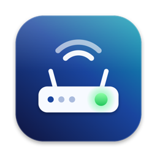
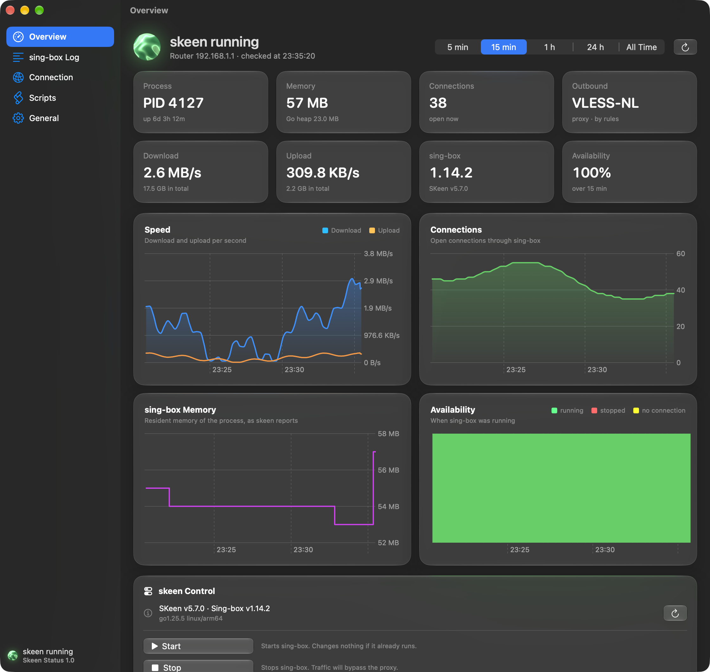
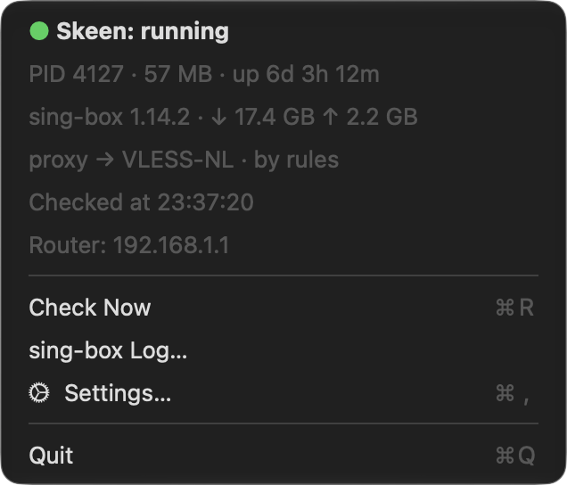
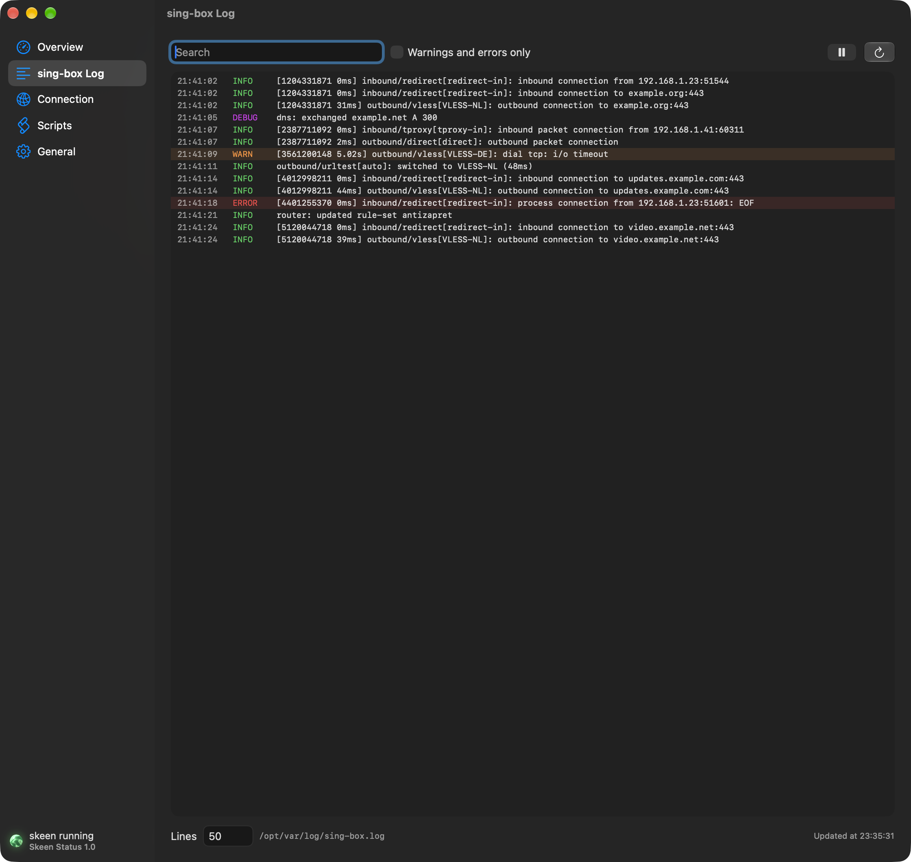
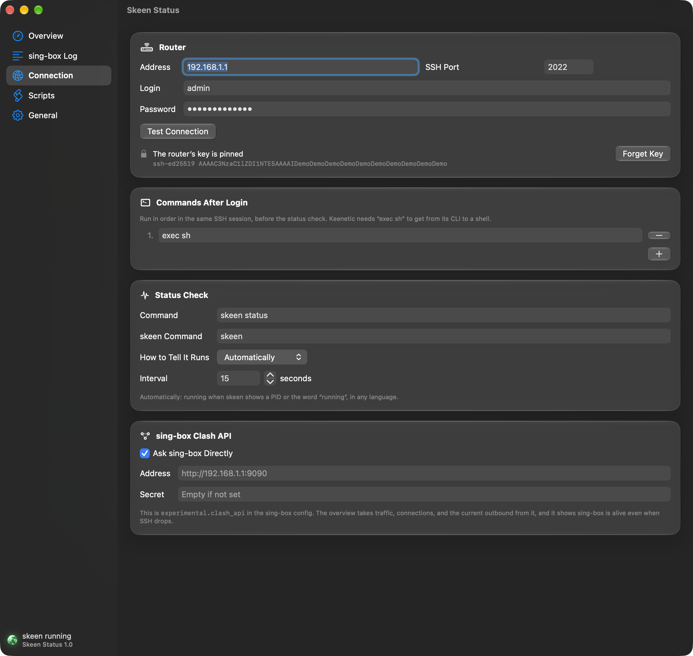
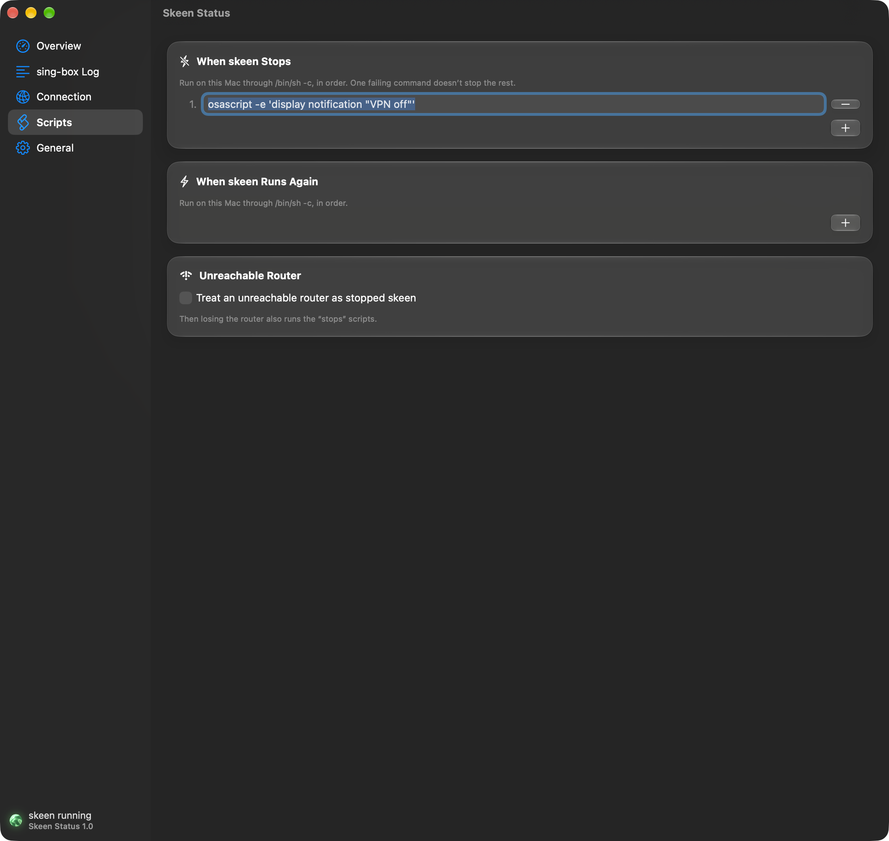
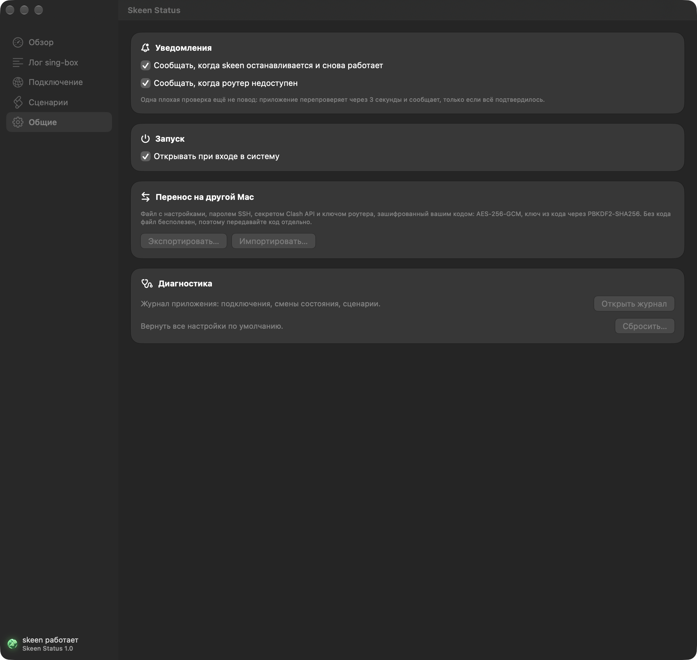

<p align="center"></p>

# Skeen Status

[](https://www.apple.com/macos/) [](https://www.swift.org) [](LICENSE)

🟢 **Skeen Status** следит за [SKeen](https://github.com/jinndi/SKeen) на вашем роутере Keenetic прямо из строки меню Mac. Точка сразу показывает, работает ли sing-box, а уведомление приходит в ту же минуту, как он остановится. Больше не придётся гадать, почему не открывается заблокированный сайт.

Приложение держит одну SSH-сессию с роутером и каждые 15 секунд спрашивает `skeen status`. А ещё читает Clash API самого sing-box: трафик, соединения и текущий выход. Из окна можно запустить или перезапустить skeen, а когда он падает или поднимается, на этом Mac выполнятся ваши сценарии.

[English version](README.md)



## Что вы получите

- 🟢 **Точка в строке меню**: зелёная, пока skeen работает, красная, когда он остановился, жёлтая, когда роутер недоступен. В меню — PID, память, время работы, трафик и выход, через который идёт трафик.
- 📊 **Обзор с графиками**: скорость, соединения, память и доступность, от последних пяти минут до всего времени. Наведите курсор на график, чтобы увидеть точное значение.
- 🔔 **Уведомления по делу**: одну плохую проверку приложение повторяет через 3 секунды, поэтому перезапуск или пробуждение Mac не поднимут ложную тревогу. В уведомлении сказано, сколько sing-box проработал или сколько длился простой, а кнопка запускает его снова.
- 🎛️ **skeen под рукой**: запустить, остановить, перезапустить, перезагрузить и проверить конфиг. Всё, что прерывает трафик, сначала спрашивает.
- 📜 **Лог sing-box**: живой хвост, фильтр предупреждений и ошибок, поиск и пауза.
- ⚙️ **Сценарии на этом Mac**: любые shell-команды, когда skeen падает или поднимается. Например, включить свой VPN.
- 🧭 **Понимает skeen, а не его формулировки**: skeen 5 пишет статус по-русски и в цвете, и приложение всё равно его читает. Живой Clash API доказывает, что sing-box работает, даже если SSH отвалился.
- 🔐 **Безопасно по умолчанию**: пароль хранится в Связке ключей, ключ роутера закрепляется при первом подключении, а если он сменится, приложение не станет говорить с самозванцем.
- 📦 **Перенос на другой Mac одним файлом**: настройки, пароль и закреплённый ключ в файле, зашифрованном вашим кодом.
- 🪟 **Liquid Glass**: окно на нативном стекле macOS 26, а шар состояния — Metal-шейдер из бегущих волн.

## Как начать

1. Установите Xcode из App Store. Подписанного релиза пока нет, поэтому приложение собирается на вашем Mac.
2. Запустите установщик. Он соберёт приложение и положит его в `/Applications`:

   ```sh
   curl -fsSL https://raw.githubusercontent.com/MairwunNx/skeen-status-macos/master/scripts/install.sh | bash
   ```

3. Нажмите на точку в строке меню, откройте **Настройки…** и укажите адрес роутера, порт SSH, логин и пароль. Значения по умолчанию подходят для обычной установки skeen: `192.168.1.1`, порт `2022`, пользователь `admin`.
4. Нажмите **Проверить связь**, затем **Сохранить**. Через несколько секунд точка станет зелёной.

Приложение запускается только в строке меню, иконки в Dock у него нет. Чтобы открыть окно, запустите его ещё раз из Finder или Spotlight.

> [!TIP]
> По умолчанию установщик подписывает приложение ad hoc, и тогда после каждого обновления Связка ключей снова спрашивает пароль. Подпишите его постоянным сертификатом, хоть самоподписанным, и вопросы прекратятся: `SKEEN_SIGN_IDENTITY="My Local Signing" bash install.sh`.

## Ещё скриншоты

| Меню | Лог sing-box |
| --- | --- |
|  |  |

| Подключение | Сценарии | Общие |
| --- | --- | --- |
|  |  |  |

## Как приложение понимает, что skeen работает

skeen печатает строку `PID:` только пока sing-box работает, а слова `running` и `stopped` не меняются ни в одном переводе. Приложение ищет именно их, поэтому новая версия skeen с другими формулировками его не сломает. Если ваша установка пишет что-то своё, выберите **По своему правилу** в настройках подключения и задайте подстроку или регулярное выражение.

Кроме SSH, приложение спрашивает сам sing-box через `experimental.clash_api`, по умолчанию на `http://<роутер>:9090`. Если API отвечает, sing-box жив, даже когда SSH лёг или skeen напечатал что-то странное. Выключить API или указать другой адрес можно на той же вкладке.

## Перенос на другой Mac

Откройте **Общие → Перенос на другой Mac → Экспортировать…** и придумайте код не короче 8 символов. На другом Mac установите приложение и нажмите **Импортировать…** с тем же кодом.

В файле — настройки, пароль SSH, секрет Clash API и закреплённый ключ роутера. Он зашифрован AES-256-GCM ключом, который выводится из кода через PBKDF2-HMAC-SHA256 с 600 000 итераций и случайной солью, а заголовок тоже защищён от подмены. Без кода файл бесполезен, поэтому передавайте их разными путями.

## Приватность и безопасность

- Пароль SSH и секрет Clash API хранятся в Связке ключей под именем `skeen-status-macos` и никогда не попадают в `config.json`.
- Конфиг лежит в `~/Library/Application Support/skeen-status-macos/config.json` с правами `0600`, рядом с журналом приложения и историей графиков.
- Приложение закрепляет SSH-ключ роутера при первом подключении и отказывается входить, если он изменился. После замены роутера нажмите **Подключение → Забыть ключ**.
- Сценарии выполняются на этом Mac через `/bin/sh -c`, а не на роутере.
- Приложение говорит только с вашим роутером и никуда больше ничего не отправляет.

## Для разработчиков

Skeen Status написан на SwiftUI и AppKit поверх [The Composable Architecture](https://github.com/pointfreeco/swift-composable-architecture), а код разложен по [Feature-Action Architecture](https://github.com/MairwunNx/Feature-Action-Architecture). SSH держит [Citadel](https://github.com/orlandos-nl/Citadel), Clash API — [Alamofire](https://github.com/Alamofire/Alamofire).

```
SkeenStatus/
  App/        корневой редьюсер, окно, строка меню, демо-режим
  Features/   Monitor, ServiceControl, Logs, Settings: редьюсер и его экраны
  Entities/   Skeen (статус, версия, команды, лог) и SingBox (Clash API)
  Shared/     конфиг, SSH, Связка ключей, уведомления, хелперы, стеклянный UI, шейдер шара
```

Слой импортирует только нижние слои, а фича никогда не импортирует другую фичу. Их делегатные действия встречаются в `AppFeature`.

```sh
xcodebuild -project SkeenStatus.xcodeproj -scheme SkeenStatus -destination 'platform=macOS' -skipMacroValidation build
xcodebuild -project SkeenStatus.xcodeproj -scheme SkeenStatus -destination 'platform=macOS' -skipMacroValidation test
```

В Xcode 27 компилятор Metal ставится отдельно, один раз: `xcodebuild -downloadComponent MetalToolchain`.

С флагом `--demo` приложение работает с выдуманным роутером: без сети, Связки ключей и файлов. На нём идут UI-тесты и сняты скриншоты выше. `--tab overview|logs|connection|scripts|general` открывает окно на нужной вкладке.

## Связанные проекты

- **[Feature-Action Architecture](https://github.com/MairwunNx/Feature-Action-Architecture)** — код нарезан на фичи, а сервисы заменены действиями. По ней разложен Skeen Status.

## Благодарности

- Иконку рисует код [`scripts/draw-icon.swift`](scripts/draw-icon.swift), она распространяется под лицензией MIT вместе с проектом.
- Идея волнового шара взята из шейдеров Shadertoy [wdyczG](https://www.shadertoy.com/view/wdyczG) и [4sS3Dc](https://www.shadertoy.com/view/4sS3Dc). Код на Metal написан с нуля.
- Вся настоящая работа на роутере — заслуга [SKeen](https://github.com/jinndi/SKeen) и [sing-box](https://github.com/SagerNet/sing-box).

> 🫡 Сделал Павел Ерохин (Pavel Erokhin), он же mairwunnx.
